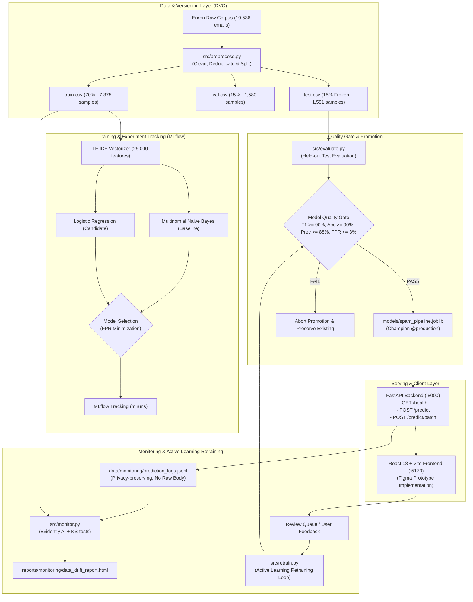

# MailGuard — Spam Email Detection System (MLOps)

**Department of AIDS** · **Course Code: 24SDAD03** · **MLOps Project Review #2**

MailGuard is a production-minded, end-to-end Machine Learning Operations system designed to identify and explain spam/phishing emails. It pairs a **React 18 + Vite** UI with a **FastAPI** backend serving a version-controlled **scikit-learn** model pipeline tracked by **DVC** and **MLflow**.

---

## 🏗️ Architecture & Component Overview



```
D:\MLOps\SEDS project\
├── data/
│   ├── raw/
│   │   ├── enron_spam_data.csv          # Authentic Enron-Spam dataset
│   │   └── enron_spam_data.csv.dvc      # DVC data manifest
│   └── processed/
│       ├── train.csv                    # 70% stratified training split (7,375 samples)
│       ├── val.csv                      # 15% stratified validation split (1,580 samples)
│       └── test.csv                     # 15% frozen held-out test split (1,581 samples)
├── src/
│   ├── ingestion.py                     # Data ingestion, schema validation & label normalization
│   ├── preprocess.py                    # Cleaning, token normalization, deduplication & stratified splits
│   ├── train.py                         # TF-IDF fitting, MNB vs. LogReg training & MLflow tracking
│   └── evaluate.py                      # Unseen test set evaluation, confusion matrix & Quality Gate check
├── models/
│   ├── spam_pipeline.joblib             # Champion production pipeline
│   ├── candidate_pipeline.joblib        # Pre-promotion candidate pipeline
│   ├── model_metadata.json              # Hyperparameters, random seed, training sample counts
│   └── evaluation_results.json          # Metrics report on the held-out test set
├── backend/
│   ├── main.py                          # FastAPI service with REST endpoints & CORS
│   ├── schemas.py                       # Pydantic request & response validation schemas
│   └── model_service.py                 # Real scikit-learn model inference & signal extraction
├── frontend/                            # React 18 + Vite + Tailwind CSS + Lucide + Recharts
├── tests/
│   ├── test_pipeline.py                 # ML pipeline unit tests
│   ├── test_api.py                      # FastAPI endpoint unit tests
│   └── test_integration.py              # End-to-end integration test suite
├── params.yaml                          # Centralized pipeline configuration & thresholds
├── dvc.yaml & dvc.lock                  # DVC pipeline stages & reproducible execution DAG
└── start_app.bat                        # Single-command launcher for Windows
```

---

## ⚡ FastAPI Production Serving Layer

The backend loads the actual scikit-learn pipeline at startup (`backend/model_service.py`), failing clearly if the model artifact is missing or invalid.

### Endpoints
* **`GET /health`**: Verifies API status and model readiness. Returns `model_loaded: true`, model version, uptime, and component statuses.
* **`POST /predict`**: Classifies a single email payload `{ sender, subject, body }`. Rejects empty input and oversized bodies (>50,000 characters). Returns predicted label (`spam` or `legitimate`), posterior spam probability, confidence, model version, and inference latency.
* **`POST /predict/batch`**: Batch classification supporting up to 100 emails in a single request. Returns individual predictions, total counts, and aggregate batch latency.
* **`GET /model/info`**: Returns model architecture, training sample counts, held-out test metrics, confusion matrix counts, and Quality Gate status.
* **`GET /metrics`**: Operational telemetry reporting total predictions, spam ratio (%), average latency, and p95 latency.
* **`GET /api/history`**: Privacy-conscious stream of recent scans (stores domain, timestamp, and snippet; **raw email bodies are never stored**).

---

## 🔁 DVC & Pipeline Reproducibility

1. **Explicit Stages in `dvc.yaml`:**
   * **`prepare`**: Ingests raw data, cleans tokens, deduplicates, and generates stratified train/val/test splits.
   * **`train`**: Fits TF-IDF strictly on the training set, trains baseline Multinomial Naive Bayes and Logistic Regression, logs metrics to MLflow, and saves the candidate model.
   * **`evaluate`**: Evaluates the candidate model on the unseen test set, checks the **Model Quality Gate**, and promotes the champion model upon passing.
2. **Reproducible Execution:**
   ```powershell
   & "D:\MLOps\.venv\Scripts\dvc.exe" repro
   ```
3. **Skipping Unchanged Stages:**
   A second unchanged run skips all stages:
   ```
   'data\raw\enron_spam_data.csv.dvc' didn't change, skipping
   Stage 'prepare' didn't change, skipping
   Stage 'train' didn't change, skipping
   Stage 'evaluate' didn't change, skipping
   Data and pipelines are up to date.
   ```

---

## 🛡️ Model Quality Gate

The pipeline defines strict promotion thresholds in `params.yaml`:
* **Min F1-Score:** ≥ `90.0%` *(Achieved: **96.6%**)*
* **Min Accuracy:** ≥ `90.0%` *(Achieved: **98.1%**)*
* **Min Spam Precision:** ≥ `88.0%` *(Achieved: **97.26%**)*
* **Max False Positive Rate:** ≤ `3.0%` *(Achieved: **1.055%**)*
* **Non-regression Check:** Prevents replacing an existing champion model with a lower-scoring candidate.

### Evaluation on Unseen Test Set (1,581 samples):
```
Overall Accuracy    : 98.1%
ROC-AUC Score       : 99.77%
Spam Precision      : 97.26%
Spam Recall         : 95.95%
Spam F1-Score       : 96.6%
False Positive Rate : 1.055% (Only 12 legitimate emails misclassified out of 1,137)
Quality Gate Status : PASSED
```

---

## 📊 Live Monitoring & Evidently AI Drift Detection

MailGuard implements automated data drift detection using **Evidently AI 0.7.23** paired with two-sample **Kolmogorov-Smirnov (KS)** tests on privacy-preserving, text-derived features (`char_length`, `token_count`, `uppercase_ratio`, `digit_count`, `url_count`, `currency_count`, and `spam_probability`).

### 1. Privacy-Conscious Prediction Logs
Every inference request through `/predict` and `/predict/batch` appends operational telemetry to `data/monitoring/prediction_logs.jsonl`. **Raw email bodies and PII are never retained.**

### 2. Monitoring Command
```powershell
# Evaluate Live Prediction Stream
& "D:\MLOps\.venv\Scripts\python.exe" src/monitor.py --stream logs

# Evaluate Authentic In-Distribution Stream (Healthy: 0/7 drifted)
& "D:\MLOps\.venv\Scripts\python.exe" src/monitor.py --stream normal

# Evaluate Shifted Phishing Stream (Warning: 7/7 drifted)
& "D:\MLOps\.venv\Scripts\python.exe" src/monitor.py --stream drifted
```

### 3. Generated Artifacts
* **Interactive HTML Report:** `reports/monitoring/data_drift_report.html` (viewable directly in browser or via `GET /api/monitoring/drift/report.html`)
* **Structured Metrics:** `reports/monitoring/drift_metrics.json`
* **Alert Thresholds:** Configured in `params.yaml` (`drift_share_threshold: 0.30`, `p_value_threshold: 0.05`). Triggers `WARNING_DRIFT_DETECTED` when $\ge 30\%$ of features exhibit distribution drift.

### 4. MLOps Principle: Data Drift vs. Model Performance Degradation
* **Data Drift ($P(X)$):** Measures shifts in input feature distributions over time compared to the training baseline without requiring ground-truth labels.
* **Model Performance Degradation ($P(Y|X)$):** Measures actual drop in classification accuracy, precision, and F1-score. **In live production, accuracy cannot be computed without ground-truth labels** obtained from human-in-the-loop review or verified feedback queues.

---

## 🔄 Automated Retraining Workflow & Quality Gate

When new validated samples accumulate in the review queue (`data/monitoring/new_labels.csv`):

### 1. Execution Command
```powershell
& "D:\MLOps\.venv\Scripts\python.exe" src/retrain.py
```

### 2. Workflow Steps
1. **Schema Validation & Deduplication:** Cleans incoming text, validates binary labels, and removes duplicates against baseline training data.
2. **Data Incorporation:** Concatenates new feedback with approved training corpus (`data/processed/train.csv`).
3. **MLflow Tracking:** Trains candidate model and logs hyperparameters, training sample count, and validation metrics to the `Spam_Email_Detection_System` experiment.
4. **Held-Out Evaluation:** Evaluates candidate model on `data/processed/val.csv`.
5. **Quality Gate & Non-Regression Check:**
   * Candidate F1 $\ge 90.0\%$
   * Candidate Accuracy $\ge 90.0\%$
   * Candidate Precision $\ge 88.0\%$
   * False Positive Rate $\le 3.0\%$
   * **Non-regression Check:** Candidate F1 must not regress below current champion model.
6. **Conditional Promotion:** If passed, promotes candidate to `models/spam_pipeline.joblib` and hot-reloads the FastAPI serving layer. If failed, deployment is aborted and the existing champion model is preserved.

---

## 🧪 Automated Test Suites

Run all test suites using the project Python environment:

```powershell
# Run All 32 Tests (Pipeline, API, Monitoring, Retraining, Integration)
& "D:\MLOps\.venv\Scripts\python.exe" -m unittest discover -s tests -p "test_*.py" -v

# Or run individual suites:
& "D:\MLOps\.venv\Scripts\python.exe" -m unittest tests\test_monitoring.py -v
& "D:\MLOps\.venv\Scripts\python.exe" -m unittest tests\test_retrain.py -v
& "D:\MLOps\.venv\Scripts\python.exe" -m unittest tests\test_api.py -v
& "D:\MLOps\.venv\Scripts\python.exe" -m unittest tests\test_pipeline.py -v
& "D:\MLOps\.venv\Scripts\python.exe" -m unittest tests\test_integration.py -v
```

---

## 🚀 How to Run on Windows

### 1-Click Launch (Recommended)
Double-click [`start_app.bat`](file:///D:/MLOps/SEDS%20project/start_app.bat). It opens two command windows:
1. **FastAPI Backend:** [http://localhost:8000](http://localhost:8000) (Swagger Docs at [http://localhost:8000/docs](http://localhost:8000/docs))
2. **React Frontend:** [http://localhost:5173](http://localhost:5173)

### Manual Terminal Launch

**Terminal 1 — Backend:**
```powershell
cd "D:\MLOps\SEDS project"
& "D:\MLOps\.venv\Scripts\python.exe" -m uvicorn backend.main:app --host 127.0.0.1 --port 8000 --reload
```

**Terminal 2 — Frontend:**
```powershell
cd "D:\MLOps\SEDS project\frontend"
npm run dev
```

---

## 🐳 Containerization & Docker Compose

The system is fully containerized using a multi-stage production Docker build with non-root security and automated model artifact resolution.

### 1. Build and Run with Docker Compose
```bash
# Build and start the entire stack (FastAPI Backend + React Frontend)
docker compose up --build -d

# Check service health and logs
docker compose ps
docker compose logs -f backend

# Launch with optional MLflow experiment tracking UI (http://localhost:5000)
docker compose --profile monitoring up -d

# Stop services
docker compose down
```

### 2. Standalone Backend Container Build
```bash
# Build standalone FastAPI container image
docker build -t mailguard-api:latest .

# Run with persistent volume mounts for models, monitoring, and MLflow
docker run -d \
  --name mailguard-api \
  -p 8000:8000 \
  -v "$(pwd)/models:/app/models" \
  -v "$(pwd)/data/monitoring:/app/data/monitoring" \
  -v "$(pwd)/reports/monitoring:/app/reports/monitoring" \
  -v "$(pwd)/mlruns:/app/mlruns" \
  mailguard-api:latest

# Verify container health
curl -f http://localhost:8000/health
```

### 3. Model Artifact Availability & Container Entrypoint
* **Image Layer:** Trained model artifacts in `models/` are baked directly into the image during `docker build`.
* **Volume Mount:** `./models:/app/models` enables dynamic model updates from continuous retraining without image rebuilds.
* **Reproducible Fallback:** `docker-entrypoint.sh` inspects `/app/models/spam_pipeline.joblib` at startup. If missing (e.g. fresh clone with empty volume), it restores the model from `backend/saved_models/` or executes reproducible training before launching the API.

### 4. Local Fallback (When Docker is Unavailable)
If Docker or Docker Desktop is not installed on the host machine:
* Run the 1-click batch script [`start_app.bat`](file:///D:/MLOps/SEDS%20project/start_app.bat) to launch FastAPI and Vite locally.
* Run tests with: `& "D:\MLOps\.venv\Scripts\python.exe" -m unittest discover -s tests -p "test_*.py" -v`.

---

## ⚙️ CI/CD: GitHub Actions Automation

Three automated workflows are configured in `.github/workflows/`:

| Workflow File | Trigger Events | Purpose & Quality Gates |
| :--- | :--- | :--- |
| **`ci.yml`** | `push`, `pull_request` on `main`/`master` | Fast path-filtered checks: builds React UI; installs Python 3.11; executes all 32 unit/integration tests; tests drift detector; enforces Model Quality Gate; lints Dockerfile. |
| **`train-and-evaluate.yml`** | `workflow_dispatch`, or push to `data/raw/**`, `params.yaml`, `dvc.yaml`, `src/**` | Retrains models from baseline data; evaluates on unseen test set; enforces strict promotion gate; archives MLflow metrics and evaluation artifacts. |
| **`retrain-scheduled.yml`** | Weekly cron (`0 2 * * 0`), `workflow_dispatch` | Automated retraining on user-validated review queue samples (`new_labels.csv`); tests candidate against held-out validation set; checks non-regression against current champion. |

### Path Filtering & Cost Optimization
To prevent expensive model training and redundant downloads on minor UI or documentation updates, `ci.yml` isolates frontend jobs from backend/ML jobs using GitHub Actions path filtering.

### GitHub Secrets & Remote Configuration
* **No Secrets Required for Core CI:** All tests, drift checks, and retraining use reproducible local datasets and mock-free pipelines.
* **Optional Secrets (for Remote Deployments):**
  * `DOCKER_HUB_USERNAME` & `DOCKER_HUB_TOKEN`: Required only if publishing images to Docker Hub registry.
  * `DVC_REMOTE_TOKEN` / `AWS_ACCESS_KEY_ID`: Required only when pushing dataset artifacts to an external S3/GCS bucket.

---

## 🔧 Troubleshooting Guide

| Issue | Root Cause | Solution |
| :--- | :--- | :--- |
| **`docker: The term 'docker' is not recognized`** | Docker or Docker Desktop is not installed on the local Windows system. | Use the local runner script [`start_app.bat`](file:///d:/MLOps/SEDS%20project/start_app.bat) or run tests via Python virtualenv directly. |
| **`MLflow: The filesystem tracking backend is in maintenance mode`** | Modern MLflow 3.x enforces explicit consent when tracking to local directory `./mlruns`. | `os.environ["MLFLOW_ALLOW_FILE_STORE"] = "true"` is set at startup in all scripts. |
| **`CORS Error in Browser Console`** | Frontend running on non-whitelisted port (e.g. 3000 instead of 5173). | Explicitly configured in `backend/main.py` and `params.yaml` allowing `*` origins and local ports `5173`, `3000`. |
| **`FileNotFoundError: spam_pipeline.joblib`** | Fresh checkout without running pipeline or volume mount missing. | Run `& "D:\MLOps\.venv\Scripts\python.exe" run_pipeline.py` or double-click `start_app.bat`. |

---

## ⏱️ 5-Minute Live Demonstration Walkthrough

Follow this exact sequence for your MLOps Project Review demonstration:

1. **Start Full Stack (`0:00 - 0:30`):**
   * Double click [`start_app.bat`](file:///d:/MLOps/SEDS%20project/start_app.bat).
   * Point the reviewers to the FastAPI Swagger docs at `http://localhost:8000/docs` (`GET /health` and `GET /model/info`).
   * Open the React frontend at `http://localhost:5173`.
2. **Single Email Prediction & Signal Explainability (`0:30 - 1:30`):**
   * Click **"Check Email"** in the sidebar.
   * Click **"Use sample email"** and select **"Urgent Lottery Prize (Spam)"**.
   * Click **"Analyze email"** -> Watch real-time posterior probability calculation (e.g. `99.6% Likely spam`).
   * Explain the 4 signal categories: Urgency language, Suspicious offer, Unknown sender, Call to action.
3. **Batch Scanner Execution (`1:30 - 2:15`):**
   * Toggle to **"Batch Scanner"** tab.
   * Click **"Load Sample Batch"** (4 emails with delimiter `Subject | Body`).
   * Click **"Process Batch Queue"** -> Displays aggregate batch latency (~7ms), spam caught, and individual verdicts.
4. **Evidently AI Drift Monitoring (`2:15 - 3:30`):**
   * Navigate to **"Model / Monitoring"** tab.
   * Show KPI cards: Model version, Uptime, P95 latency (<2ms), Data drift status (`Low`).
   * Click **"Drift Report"** modal:
     * Toggle **"Drifted Phishing Stream"** and click evaluate -> Watch live status transition to **`WARNING_DRIFT_DETECTED` (7/7 features drifted, 100% share)**.
     * Click **"Open Full Evidently AI Report"** -> Opens the interactive 3.9 MB HTML report with distribution violin plots.
     * Explain the MLOps distinction: *Data drift evaluates input distribution $P(X)$, whereas true model accuracy requires verified ground truth labels.*
5. **Human-in-the-Loop Feedback & Automated Retraining (`3:30 - 4:30`):**
   * Navigate to **"Feedback"** tab.
   * Show the review queue of ambiguous predictions and verified labels.
   * Click **"Retrain on New Labels"** -> Watch candidate training, MLflow experiment logging, validation evaluation, and **Model Quality Gate** pass (`F1 >= 90%`, `FPR <= 3%`).
   * Show that candidate is promoted to production with zero downtime.
6. **Reproducibility & Test Verification (`4:30 - 5:00`):**
   * Open terminal and run:
     ```powershell
     & "D:\MLOps\.venv\Scripts\dvc.exe" repro
     & "D:\MLOps\.venv\Scripts\python.exe" -m unittest discover -s tests -p "test_*.py" -v
     ```
   * Show that all DVC stages skip (`Data and pipelines are up to date`) and all **32 automated tests pass** (`OK`).
